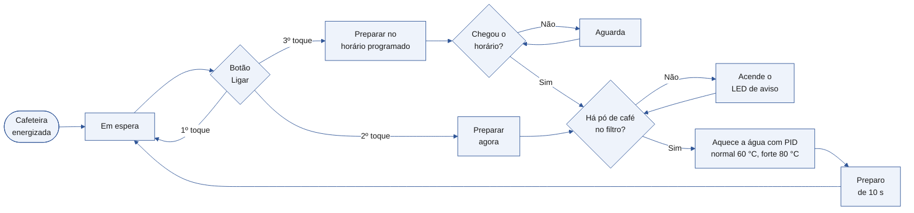
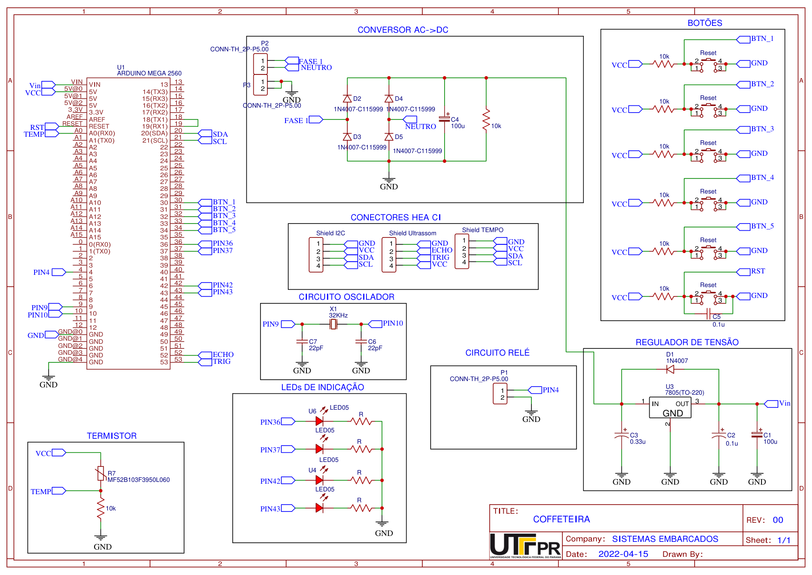
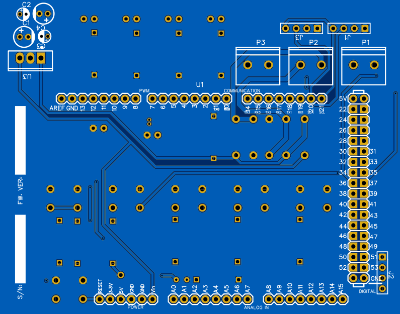
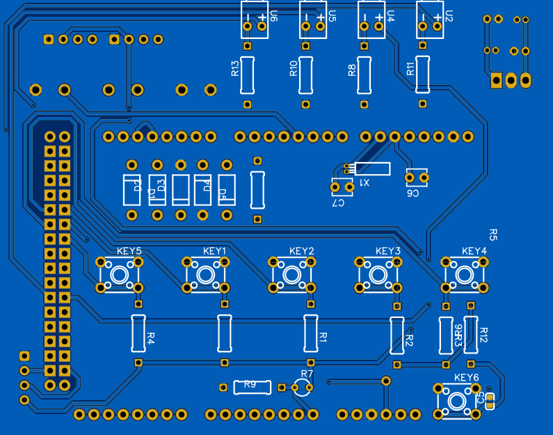
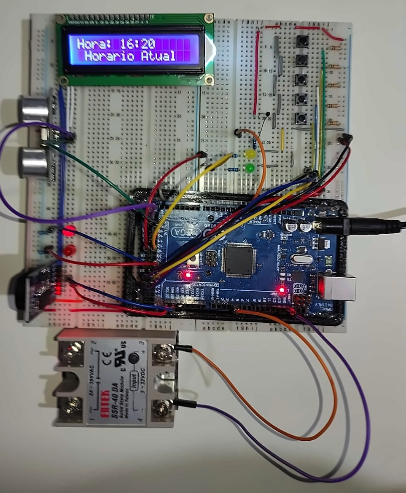

# Coffeteira, cafeteira programável com Arduino

Protótipo de uma cafeteira programável com **Arduino Mega 2560**, com relógio de tempo real, programação de horário, escolha entre café normal e forte, **controle PID** da temperatura da água e **sensor ultrassônico** que verifica se há pó de café no filtro. O projeto inclui firmware, esquemático, placa de circuito impresso e manual do usuário. Foi desenvolvido em equipe de quatro integrantes na disciplina de Sistemas Embarcados do curso de Engenharia Eletrônica da UTFPR, em 2022.

> **English:** programmable coffee maker prototype built in a four-person team for the Embedded Systems course (UTFPR, 2022). Arduino Mega 2560 firmware with an RTC, PID water-temperature control through a solid-state relay, ultrasonic coffee-powder detection and an I2C LCD, plus schematic and PCB design in EasyEDA.

## Funcionalidades

- **Relógio** com hora atual no LCD, mantida pelo módulo RTC DS3231
- **Ajuste de hora e minuto** pelos botões
- **Programação de horário** para o café ficar pronto na hora escolhida
- **Intensidade** normal (água a 60 °C) ou forte (80 °C), indicada por LEDs
- **Três modos** no mesmo botão, em espera, preparar agora e preparar no horário programado
- **Verificação de pó de café** pelo sensor ultrassônico HC-SR04 antes de iniciar o preparo, com indicação por LED
- **Controle de temperatura PID**, com leitura de um termistor NTC e acionamento da resistência por PWM em um relé de estado sólido

### Fluxo de funcionamento

*Fluxo do firmware. A intensidade do café, normal ou forte, é escolhida antes pelo botão de intensidade.*

## Hardware

| Bloco | Componentes |
|---|---|
| Controle | Arduino Mega 2560 (ATmega2560) |
| Alimentação | Retificador com diodos 1N4007 e regulador 7805 |
| Interface | LCD 16x2 com módulo I2C, 5 botões e LEDs de indicação |
| Sensores | Termistor NTC 10k e ultrassom HC-SR04 |
| Tempo | Módulo RTC DS3231 |
| Atuação | Relé de estado sólido SSR-40 DA para a resistência de aquecimento |

O custo estimado de fabricação ficou em cerca de **R$ 188** por unidade, incluindo a placa de circuito impresso.

### Placa de circuito impresso

| Face 1 | Face 2 |
|---|---|
|  |  |

*Layout da placa de duas faces feito no EasyEDA, no formato de shield para o Arduino Mega.*

### Protótipo

*Protótipo funcionando na protoboard, com o Arduino Mega, o relé de estado sólido, o RTC, o sensor ultrassônico, os botões e o LCD mostrando a hora.*

## Recursos de sistemas embarcados usados

| Recurso | Onde aparece |
|---|---|
| Registradores do ATmega2560 | Leitura dos botões direto em `PINC` e configuração de portas com `DDRx` e `PORTx` |
| Interrupção externa | `ISR(INT2_vect)` trata qual botão foi pressionado |
| PWM | Acionamento da resistência pelo pino 4 |
| Controle PID | Biblioteca PIDController, com saída limitada a 0–255 |
| Comunicação I2C | LCD e RTC no mesmo barramento |
| Medição de tempo de pulso | Distância do ultrassom calculada com `pulseIn` |

## Arquivos

| Caminho | Conteúdo |
|---|---|
| `Coffeteira/Coffeteira.ino` | Firmware completo |
| `hardware/esquematico.pdf` | Esquemático em PDF |
| `hardware/easyeda-projeto.zip` | Projeto do esquemático e da PCB no EasyEDA |
| `hardware/gerber-pcb.zip` | Arquivos Gerber para fabricar a placa |

## Como compilar

1. Abra a pasta `Coffeteira` na Arduino IDE e selecione a placa **Arduino Mega 2560**.
2. Instale as bibliotecas **RTClib**, **PIDController**, **Thermistor** e **NewLiquidCrystal** (que fornece `LCD.h` e `LiquidCrystal_I2C.h`).
3. Para ver a temperatura e a saída do PID no monitor serial, descomente a linha `#define teste`.

## O que eu faria diferente hoje

- **Sintonia do PID.** As constantes Kp, Ki e Kd foram definidas sem sintonia, como o próprio código registra. Eu levantaria a resposta do aquecedor e ajustaria os ganhos por um método como Ziegler-Nichols.
- **Tempo de preparo fixo.** O preparo dura 10 segundos, para caber na apresentação em aula. Num produto real, ele dependeria da quantidade de água.
- **Configuração dos botões.** Os botões são lidos no PORTC, mas os registradores de direção configurados são o `DDRE` e o `DDRB`. Funciona porque os pinos já começam como entrada, mas a configuração deveria ser no `DDRC`.
- **Interrupção simulada.** A interrupção externa é disparada por um pulso gerado pelo próprio software em outro pino. Seria mais simples usar interrupção por mudança de pino (PCINT) direto nos botões.
- **Leituras bloqueantes.** `pulseIn` sem tempo limite pode travar o laço principal se o sensor não responder.
- **Função sem uso.** A rotina que apaga a luz de fundo do LCD está escrita, mas nunca é chamada.

---

Projeto desenvolvido em equipe. Repositório mantido por **Isadora Fernanda Zappe Schmidt** · [LinkedIn](https://www.linkedin.com/in/isadora-fernanda)
